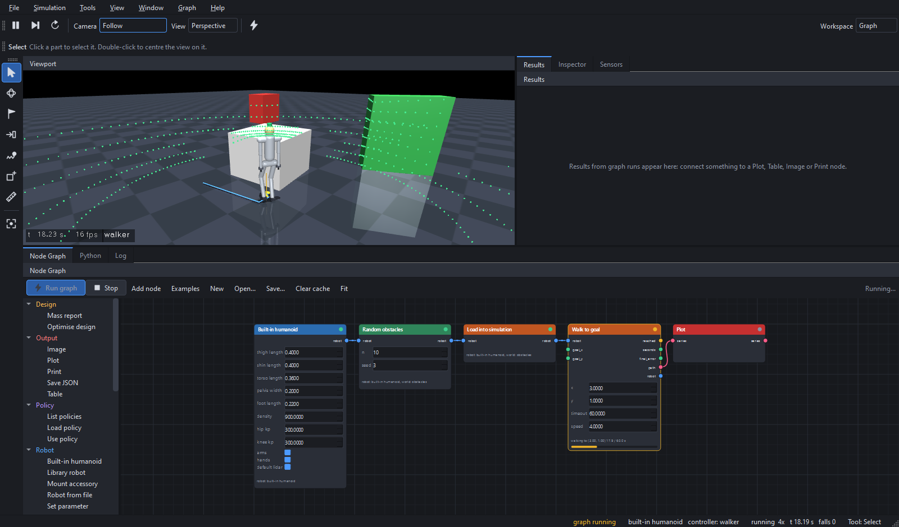
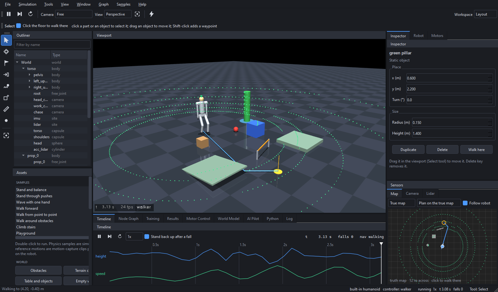
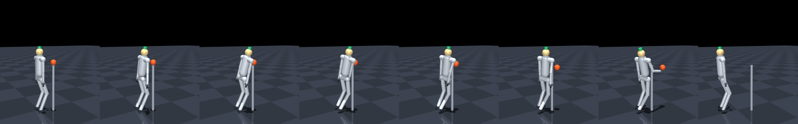
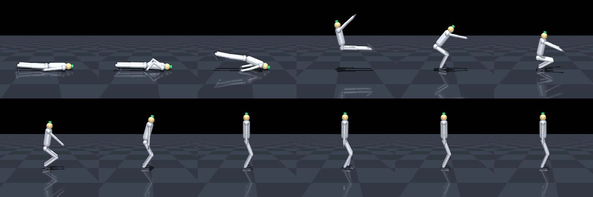
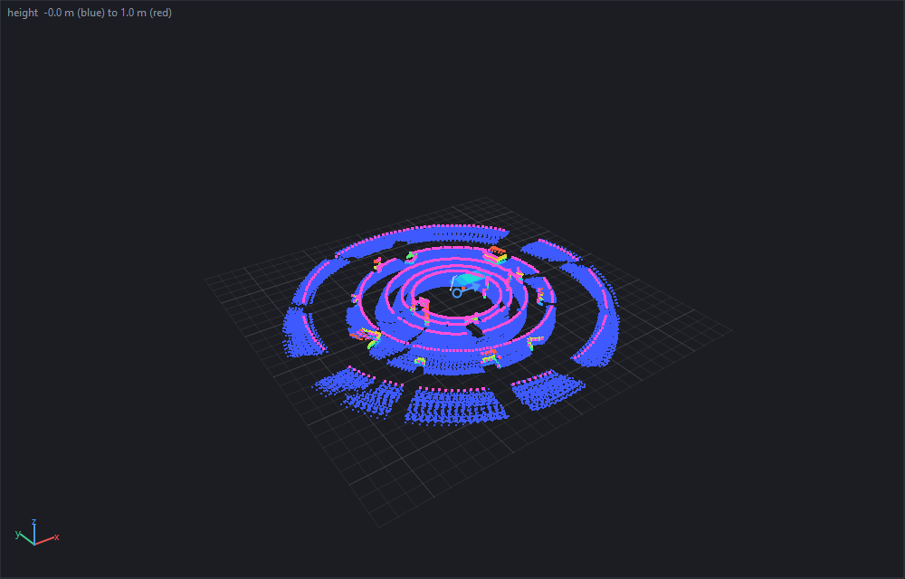

# Simulatics

A humanoid robot workbench for Windows: design a robot (sliders, CAD parts, topology optimisation, AI design
search), simulate it in MuJoCo, click anywhere and watch it walk there to within millimetres (over steps,
stairs and ramps, recovering from pushes), use its arms and hands, give it a lidar and cameras, localise it
with SLAM, connect it to ROS 2, train walking and motion-imitation policies with methods from the published
literature, and let a language model pilot it from camera images.

> **Independent project.** Simulatics is a standalone personal project. It is not affiliated with, sponsored
> by or endorsed by any university, company or other software project. Third-party names appear only where
> needed to say what Simulatics works with or to credit work as its licence requires, and they belong to
> their owners. All third-party software and data are used under, and in line with, their own licences. See
> [Disclaimer](#disclaimer).

Released under the MIT License, except the motion-capture sample clips, which keep their own terms; see `LICENSE` and
`THIRD_PARTY_NOTICES.md`.

Python for the application, MuJoCo's C engine for physics, C++ kernels for planning, mapping, batched
inference, SLAM scan matching, MPC and topology optimisation. Two front ends share the engine: a native
desktop workstation (Simulatics Studio, Qt) and a browser GUI served from the local machine.

`docs/METHODS.md` maps each method from the literature, with its paper, to the module that implements it.

## Quick start

From a checkout, one command sets everything up and starts the app (on Windows, double-click `run.bat`):

```bash
python run.py
```

| Command | What it does |
|---|---|
| `python run.py` | Starts Simulatics Studio from this source. The first start creates `.venv` and installs the dependencies (a few minutes). |
| `python run.py exe` | Downloads the latest released `SimulaticsStudio.exe` next to the script and runs it. No Python packages needed. |
| `python run.py web` | Starts the browser GUI instead. |
| `python run.py update` | `git pull`, then starts Studio. |

Once it is open, try Samples > Acrobatics > Backflip, or Samples > Trained skills > Uppercut.

## Simulatics Studio (desktop workstation)



A native desktop app with dockable panels around a 3D viewport and a node graph, built on the same engine as
the browser GUI:

```bash
.venv\Scripts\python.exe -m pip install -e .[studio]
```
```bash
.venv\Scripts\python.exe -m simulatics studio
```

- **Click to walk, and build the scene by clicking.** With the Select tool (the default), click the floor and
  the robot plans a path and walks there. Pick an object in Assets > Build the scene (box, wall, pillar,
  platform, step, ramp, table, jump box, hurdle, ball, crate, cube, cup), click the floor to drop it, click it
  to edit its place, turn and size, drag it to move it, press Delete to remove it. The robot keeps its place
  while the scene changes. File > Save Scene / Open Scene stores scenes as JSON.

  
- **Every panel resizes.** Drag any divider: panels shrink as far as you like (their content scrolls), so the
  viewport can take as much of the window as you want. Ctrl+Space, or the frame button in the top bar, fills
  the window with the viewport (or the panel under the mouse); press it again to go back.
- **Dockable panels.** Viewport, Outliner, Inspector, Robot, Motors, Assets, Timeline, Node Graph, Results,
  Training, Sensors, AI Pilot, Python and Log can each be dragged, tabbed, floated or closed. Five workspaces
  (Layout, Graph, Train, Sensors, Animate; Alt+1 to Alt+5) rearrange them, and your own layouts can be saved.
- **Native 3D viewport** drawn by MuJoCo's renderer. Right-drag orbits, middle-drag pans, the wheel zooms.
  Shadows and reflections switch themselves off when the frame rate drops too low.
- **Tool bar and options bar** (single-key shortcuts; the bar under the menu shows the active tool's settings): Select (Q), Orbit (W), Walk to (G: click the floor), Push (P), Grab (B:
  drag a part with a spring), Place accessory (A: click the robot to mount a lidar, camera or payload) and
  Measure (M).
- **Node graph.** Wire robot, world, simulation, sensor, training, policy, design, script and output nodes
  together and press Run (Ctrl+Enter). It runs in the background, shows progress on each node, and reuses
  cached results for nodes that did not change. Tab or right-click adds a node; graphs save as JSON. Four
  examples are under Graph > Examples. A graph acts on the live simulation, so you watch it happen.
- **Timeline.** Play, pause, step, speed, and a recording of the last few minutes that can be scrubbed back.
- **Python inside.** A console and a script editor with `session`, `viewport`, `graph`, `np` and `mujoco` in
  scope; a Python script node does the same inside a graph.
- **Inspector.** Click any part to edit its mass, joint limits, damping and motor gains on the running model.

The graph engine has no Qt in it (`simulatics/graph`), so graphs also run headless:

```python
from simulatics import graph as G
g = G.EXAMPLES["Walk to a goal"]()
results = G.Executor().run(g)
```

Not in Studio yet (use the browser GUI for these): the CAD and topology-optimisation views, the ROS 2 bridge
panel, arm and hand commands (reach, grasp, gestures), importing motion-capture files, navigating on the SLAM
map, and the training task settings. Design search is available as a graph node only.

### Download

A ready-built Windows app is attached to each release: download `SimulaticsStudio.exe` from
https://github.com/Raxirex/simulatics/releases and run it (no Python needed; about 200 MB, and the first start
takes several seconds while it unpacks). It keeps trained policies and its log in `Documents\Simulatics`.
Windows may warn that the file is from an unknown publisher, because it is not code-signed.

Build it yourself from a checkout (the equivalent of `make`):

```powershell
powershell -ExecutionPolicy Bypass -File scripts\build_exe.ps1
```

Pushing a tag such as `v0.4.0` makes GitHub build the exe and publish the release
(`.github/workflows/release.yml`).

### Samples

Samples menu in Studio (or the Samples list in the Assets panel), and from Python
`samples.run(session, "backflip")`. Each sample says which kind it is:

| Kind | Samples | What you are looking at |
|---|---|---|
| Physics, controllers | Stand and balance, Stand through pushes, Wave with one hand, Walk forward, Walk from point to point, Walk around obstacles, Climb stairs, Playground, Parkour course, Kitchen | The robot's own balance and walking controllers in the physics simulation |
| Physics, recorded motor commands | Backflip, Vertical jump, Broad jump, Jump a hurdle, Jump onto a box, Jump down from a box | Motor commands only; gravity and contact do the rest (see below) |
| Physics, trained skill | Uppercut | A move the robot learned by parallel search in physics (see Skill training) |
| Reference motion | Front flip, Front handspring, Cartwheel, Handstand, Stand on one hand, and the original take of each physical one | A motion-capture take played back pose by pose, on repeat; not simulated. Click the floor and the robot stands up and walks there. |

### Physically simulated jumps and flips

The acrobatic and parkour samples start from a motion-capture take, which is only a sequence of poses. The
tracker in `simulatics/imitate/physical.py` finds motor commands that make the simulated robot perform it,
by sampling-based control reconstruction (Liu et al., SIGGRAPH 2010): the take is cut into 0.1 s windows; in
each, a few thousand candidate corrections to the servo targets are simulated in parallel from the states
kept so far, and the ones that end closest to the take (pose, orientation, centre of mass, feet, balance)
are kept. A clip takes one to three minutes on a laptop CPU. The result is a recording of motor commands.

What "physical" means here, and what is tested for every one of them (`tests/test_physical.py`):

- The robot starts standing at rest. While the motion plays, the controller writes motor commands and nothing
  else: no pose is set, no force is applied, nothing holds the robot. Replaying the same commands with plain
  `mj_step` reproduces the motion.
- It really leaves the ground (measured from contacts) and, for the backflip, really turns over (6.25 rad).
- When the recording ends, the balance controller takes over the robot as it stands, with no reset, and the
  robot is upright and still. You can then send it walking.

Limits you should know:

- **Open loop.** A recording replays exactly on the robot and world it was made for, from its standing start.
  It does not react to pushes, and it refuses to play on a different robot (changed dimensions, masses,
  accessories or objects). Four of the six do not survive a start state nudged by a micrometre, so they may
  not reproduce on a machine whose arithmetic differs in the last digit.
- **Stronger motors for four of them.** Backflip and both box jumps use an "athletic" motor preset (hip 300,
  knee 360, ankle 180, waist 200 Nm instead of 150, 180, 120, 100), set visibly in the Robot panel. Landing
  a one-metre drop needs about 245 Nm per knee at this robot's 42 kg. Vertical jump, broad jump and hurdle
  use the default motors.
- **Servo interface.** During a recording the position servos may be commanded past the joint range, so
  they can ask for their full torque at any angle; the torque limits themselves are unchanged.
- **Not physical yet:** front flip (it rotates fully but falls on landing), cartwheel, front handspring,
  handstand and the one-hand stand. These need arm strength and balance the tracker has not found. They
  remain reference motions and are labelled so.
- **The hurdle** is a standing jump over a bar as high as the simulated feet clear. The running take in the
  source data starts mid-run, which a robot starting at rest cannot follow.

Rebuild or add your own: `python -m simulatics.samples.build_physical` (all) or with clip names; add
`--seed 2` to retry the ones that failed with another random draw.

### Jump onto a box of any height

Samples menu, "Jump onto a box of any height...": type a height and the robot tries it in physics
(`simulatics/samples/boxjump.py`). The motion-capture jump is reshaped for that height, the tracker searches
for motor commands (one to four minutes), and the result is played and checked in the live session: the
attempt counts only if the robot ends standing still on the box. Heights that worked are kept and replay at
once.

What was measured on the default robot with the athletic motor preset:

| Box height | Result |
| --- | --- |
| 0.20, 0.30, 0.40, 0.50, 0.60 m | lands and stands; these recordings ship with Simulatics |
| 0.68 m | made it in one build (the "Box jump up" sample), failed in two later searches: at its limit |
| 0.80, 0.90, 1.00 m (arms) | fails: the centre of mass rises 0.3 to 0.4 m, far short of the box |

From 0.80 m the robot is told to bring its arms forward onto the box and gets stronger arm motors. That does
not get it up: the reference only points the arms at the box, nothing in it makes the hands carry weight, and
the legs alone cannot lift the body that far. A real climb (hands on the edge, pull and swing a leg up) is a
different motion that has not been built. The command says so when an attempt fails, with how far it got.

```bash
.venv\Scripts\python.exe -m simulatics.samples.boxjump 0.35 0.55      # try heights from the command line
```

### Skill training (parallel)

Teach the robot a new move by trying thousands of variations at once (`simulatics/skills`). A skill is a scene
plus a reward. Training searches for a motor program (a smooth time course of servo-target offsets for the
joints the skill may move): every generation a population of candidates is simulated in parallel on all CPU
cores, each from several slightly different starts, scored, and the search moves toward the best
(cross-entropy method). A candidate is scored by its worst attempt, which is what makes the result hold up.
The learned move ends with a balanced return to the standing stance, so the balance controller can take over.

```bash
.venv\Scripts\python.exe -m simulatics.skills uppercut --generations 160 --population 320
```

In Studio: Training panel, method "Skill", then Start; the curve updates live, and the result appears under
Trained policies (double-click to play it).

**The demo: an uppercut.** A ball sits on a tee at chest height. The reward is how high the ball is sent, the
upward speed of the fist at contact, and still standing where you started. Training on this laptop's CPU
(about 100,000 physics steps per second across 16 threads) takes six to ten minutes. The shipped result is the
"Uppercut (trained)" sample; its measured numbers are in `simulatics/skills/data/index.json` (160 generations
of 320 candidates on 3 varied starts each, 49 million physics steps: the fist meets the ball at 5 m/s and the
ball goes 1.6 m up; the robot stays on its feet in 23 of 24 varied starts).



It is not a textbook punch: the search found that leaning in nudges the ball off the tee and the rising fist
then catches it. Nothing told it how to punch, only what counts as a good result.

**Getting up from the floor.** "Get up (from lying face down) (trained)" starts with the robot lying on its
front, at rest, and ends with it standing under the balance controller. How it does it was dictated by the
body: the arms have no shoulder rotation and the elbows bend one way only, so the hands can only press on the
floor beside the hips, which lifts the hips and not the chest. A push-up is impossible; pressing tips the
robot over its head. The skill uses exactly that: press, roll forward over the head, tuck late, land on the
feet in a deep squat, stand up. The search started from that rough plan (`SkillSpec.baseline`) and tuned it
(150 generations of 320 candidates, 104 million physics steps); the live check passes (no fall, upright and
still after the hand-over).



Its limits: it is one recording for one start (lying flat, face down, at rest). With the joints perturbed by
0.02 rad at the start it usually does not end standing, so it is not a recovery reflex that works from
wherever the robot fell, and it is not triggered automatically after a fall. Getting up from lying on the
back is defined (`getup_back`) but has no working result: a rock-up and a prop-up on the arms both failed.
Two earlier approaches also failed and are kept out of the samples: tracking the motion-capture get-ups, and
searching without a starting plan (it converged on a crouch at 45 % of standing height).

A new skill is a few lines:

```python
from simulatics import skills

def reward(r: skills.Rollout):                       # r holds every simulated attempt, as arrays
    return r.body_pos("left_hand")[:, :, 2].max(axis=1) + r.stays_standing()

spec = skills.SkillSpec("raise_hand", "Raise the left hand", "...", joints=["left_shoulder_y", "left_elbow"],
                        reward=reward, duration=0.6)
tape = skills.SkillTrainer(spec, skills.TrainConfig(generations=40)).run()
skills.play(session, tape)
```

What it is not: the result is an open-loop motor program for one situation (with small variations), not a
policy that reacts to what it sees; for those there is PPO (`train/ppo.py`) and motion imitation
(`imitate/train.py`). It runs on CPU threads. `skills.Backend` is the seam where a GPU simulator (MuJoCo MJX
or MuJoCo Warp, thousands of robots per step) would plug in; none is installed, and `GpuBackend` says so. A
second skill, "kick", is defined but has no trained result (balancing on one leg without feedback is hard
for an open-loop program).

### Projects and imports

A project is a folder with `project.json` in it: the robot and its parameters, accessories, every object in
the scene, motor edits, the controller, sensor settings, the node graph, the window layout and camera, the
lidar point cloud, and the exact simulation state at the moment of saving. Opening it continues where you
left off. File > New Project, Open Project, Save Project (Ctrl+Shift+S); recent projects are listed. Nothing
about your computer or you is written into a project, and robot files inside the folder are stored by
relative path, so the folder can be moved or shared.

File > Import (Ctrl+I), or dropping a file onto the window, takes anything and works out what it is: a
project folder, a scene, a node graph, a robot model (.xml, .urdf), motor values, motion capture (.bvh), a
motion, a recorded motion or trained skill, a policy, a lidar point cloud (.ply).

Motor values come from a table (.csv or .json) with a `name` column and any of `kp`, `kv`, `torque`, `gear`,
`damping`, `armature`. A name can be a motor, a pattern or `*`:

```
name,kp,kv,torque
*_knee,350,20,220
left_hip_y,300,18,180
```

Motors panel > Import values / Export values does the same. Motor edits are kept when the scene or the
accessories change.

### Robot dog

The robot dog trots to wherever you click (Samples > Robot dog, or load it in the Robot panel and click the
floor): a trot gait with foot placement from the body's speed, analytic leg kinematics, and attitude and
height feedback (`simulatics/control/quadruped.py`). Measured: about 0.7 m/s, stops within 2 cm of the goal,
recovers from sideways shoves up to about 250 N. Flat floor only: it does not handle steps or terrain yet.

### Lidar 3D view

The "Lidar 3D" panel shows only what the lidar has seen: every point it hit since recording started, kept as a
5 cm voxel map (up to 400,000 points), with the sensor's path, the latest scan highlighted and the robot's
position. Drag to orbit, right-drag to pan, wheel to zoom; colour by height, distance or age. Save and load
as .ply (opens in common point-cloud viewers) or .npz; a project stores it too.



### Simulator tools

Standard simulator tools, written for a CPU and a Python code base:

- **System identification** (Motor Control panel): fit a joint's damping, rotor inertia and dry friction
  (optionally the servo gains) so the simulation reproduces a recorded response, from the scope or from a CSV
  log of a real motor (`time, target, angle`). The built-in self-test hides a change in the joint, records,
  and finds it again: exact from a clean recording, within 5 to 20 % from a noisy one. `simulatics/sysid.py`.
- **Validation** (Validation panel): run a task on copies of the robot with randomised physics (friction,
  masses, motor strength, stiffness, damping, a payload, a shove) and under other solver settings (half the
  time step, other integrators, friction cone, solver, softer contacts). Measured here: walking passes 13 of
  15 variants (it fails under the Euler and RK4 integrators), standing passes all, and the open-loop recorded
  motions pass only a few, which is the honest measure of how fragile they are. `simulatics/validate.py`.
- **Recording**: Ctrl+R records the viewport and saves an animated GIF.
- **Driving by keyboard**: with the viewport focused, the arrow keys walk the robot (up: ahead, left and
  right: turn, down: stop). Works for the humanoid and the dog.

Not taken on, and why: GPU-parallel simulation, soft bodies and fluids, differentiable physics, Gaussian
splats and world-model evaluation need a GPU or large dependencies; a second physics engine for true
cross-engine checks is a separate project.

### Worlds

Assets panel > World, or `session.load_world("kitchen")`:

- **Playground:** a ramp and platform, stepping blocks, slalom posts, a tunnel, balls to kick, crates to push.
- **Parkour course:** low random steps, stairs and a ramp down the middle (the walking controller crosses
  them), with hurdles, jump boxes, a drop platform and a balance beam beside the lane.
- **Kitchen:** a worktop with a cup, an apple and a butter box inside the arms' reach, a hob, sink,
  cupboards, fridge, island and dining table.

### Motor Control

A panel (workspace "Motors") for driving one motor precisely: hold the robot on a stand with its feet off the
floor, type a target to 0.01 degree, or run a step, sine, square or chirp timed by the simulation clock. A
scope shows target, angle and torque recorded at every control step, with measured rise time, overshoot,
error and time spent at the torque limit, and the motor's gains can be changed while it runs.

### World Model (placeholder)

A socket for a model that turns an instruction in words plus what the robot senses into action
(`simulatics/worldmodel`, and the World Model panel). The interface is
`act(observation, instruction) -> Action`, where an action is joint targets, a walking goal, or a named skill.
**No trained world model is included.** The built-in stand-in only matches phrases ("walk to 2 1", "do a
backflip", "jump onto the box", "stop") so the loop can be seen working. Loading your own model file runs
its code on your machine, so only load files you trust.

## Run it (browser GUI)

```bash
.venv\Scripts\python.exe -m simulatics
```

This opens the GUI at http://127.0.0.1:8765. The 3D view loads three.js from a CDN, so the first start needs
an internet connection.

Fresh checkout:

```bash
python -m venv .venv
```
```bash
.venv\Scripts\python.exe -m pip install -e .[dev]
```
```bash
.venv\Scripts\python.exe -m simulatics build-native
```

`build-native` needs CMake and a C++ compiler (Visual Studio Build Tools on Windows). Without it everything
still works through Python fallbacks, only slower. STEP export needs the optional `[step]` extra
(build123d, about 300 MB). No PyTorch or GPU is required.

### Robot library

Besides the built-in parametric humanoid, the Model tab can load robots from
[MuJoCo Menagerie](https://github.com/google-deepmind/mujoco_menagerie), downloaded on first use from a pinned
commit into `robots/` (not stored in this repository; each folder keeps its own `LICENSE`):

| Robot | Licence | Notes |
|---|---|---|
| PNDbotics Adam Lite (humanoid) | MIT | starts on a support stand: it has no balance controller here |
| Unitree Go2 (robot dog) | BSD-3-Clause | stands on its own (Menagerie has no MIT-licensed quadruped) |

```bash
.venv\Scripts\python.exe -m simulatics.robots fetch go2 adam_lite
```

Library robots hold their stand pose with a joint PD controller (gains capped by each joint's inertia so the
explicit PD stays stable) and take Workshop accessories like the built-in robot; they do not walk yet.

### AI pilot

The AI Pilot tab uses the Anthropic API. Either set `ANTHROPIC_API_KEY`, run `ant auth login`, or paste a key
into the tab (it stays in the server's memory and is sent only to Anthropic). Missions have turn, cost and
time limits, and a refusal fallback to another model is on by default (switchable). Without credentials, the
offline scripted pilot runs simple missions ("walk to the red box", "pick up the blue cube", "wave").

## What the GUI does

| Tab | Features |
|---|---|
| **Model** | Sliders for limb lengths, radii, density, motor stiffness and torque limits, timestep, friction; arms and hands toggles. Each change regenerates and recompiles the MJCF. Export MJCF, or import any MJCF/URDF file. |
| **Workshop** | The robot stands still, seen from the front (rotate, or jump to side / back / top views) in front of a coordinate backdrop (height and side in metres). Drag a lidar, cameras or a payload from the palette onto the robot: they snap to the surface and a 5 mm-5 cm grid and stay where dropped. Works on library robots too; the built-in robot's head lidar can be switched off to start bare. Drag mounted parts to move them; edit position, field of view and mass in the list. The lidar stays level wherever it is mounted; cameras look out of the surface and appear in the Sensors tab and the AI pilot's `look` tool. |
| **Motors** | Per-motor table edited live in the compiled model: kp, kv, torque limit, joint damping, rotor inertia, manual targets. |
| **Sensors** | Spinning lidar drawn as a point cloud; RGB or depth cameras (`head_cam`, `work_cam` looking at the hands, `chase`); foot contact forces. ROS 2 bridge: connect to a rosbridge server (or native rclpy) and publish /tf, /odom, /scan, /imu, /joint_states, camera, /map, /plan, /robot_description; take /cmd_vel, /goal_pose (RViz "2D Goal Pose") and arm commands. |
| **Walk** | Double-click the floor to send the robot there; Ctrl + drag to also set the direction to face; Shift to queue goals. Choose the controller (model-based walker with push recovery, MPC, learned policy, evolved policy, manual). Planned path and footsteps are drawn (at terrain height); the stopping error is shown. Push the robot from any side. Terrain courses (random steps, stairs, ramps). Plan on the ground-truth map, the lidar map, or the SLAM map with the SLAM pose, with the estimate, its uncertainty and the SLAM / odometry / true trails drawn. |
| **Arms** | Table with graspable objects; reach a point or an object, grasp, release, point, wave, raise, home. "Auto" picks the hand on the object's side. |
| **AI Pilot** | Claude (Opus 5.5 by default, or Sonnet 5.5, Haiku 5.5, Fable 5.2) or the offline pilot runs a mission in plain language. The transcript shows the model's text, tool calls, results and the camera images it saw, with token and cost counters. |
| **Design** | CAD parts with real masses; simulate with CAD geometry; download STL/OBJ/GLB/STEP or URDF. Topology-optimise a link under loads taken from simulated walking, view the result, and put it on the robot. CMA-ES or Bayesian optimisation of body proportions and motor gains, each candidate scored by simulated walking. |
| **Train** | PPO velocity tracking (Rudin et al. 2021 recipe), distil the model-based walker into a network, motion imitation (DeepMimic-style tracking), evolution strategy, genetic algorithm. Live chart, trained policies to load and use. Motion clips: preview, play with balance control, import your own BVH (retargeted to the robot). |

## Measured on an 8-core laptop CPU (no GPU used)

| What | Result |
|---|---|
| Click-to-walk, default robot, 3 m | stops 4 mm from the goal, 13 s |
| Walk to (2, 2) ending at 90 deg | 8 mm, 0.2 deg |
| Random bodies and goals (thigh/shin 0.28-0.55 m, pelvis 0.14-0.30 m, feet, density, torso) | 320/320 reached, 0 falls, mean error 5-6 mm, max 1.6 cm |
| Path around obstacles in the GUI | 7 mm at (3.5, 2.0) facing 90 deg |
| Walk up to a table and pick an object (scripted pilot) | 8/8 random scenes and starts |
| Arm reach accuracy | about 1 mm |
| Topology optimisation of the thigh (40x10x10 voxels, 40 iterations, C++) | about 11 s, 29% lighter at 94% of the tube's stiffness |
| PPO environment throughput (64 envs, 8 threads) | about 24k physics steps/s |
| Walker compute | about 0.6 ms per 5 ms control tick (8x real time) |
| MPC walker (LIPM MPC with footstep adaptation, own QP solver) | 0.2-0.5 cm at the goal on three body shapes; 2-4 ms per solve |
| Push recovery while walking, 0.1 s torso push (n=16, unseen seed) | sideways 60 N 15/16 (was 9/16), 100 N 8/16 (was 0/16); standing 140 N 8/8 (was 0/8) |
| Terrain | random 1-5 cm steps 9/10 seeds; 6-8 cm stairs and 8 deg ramps pass; 3-9 mm at the goal |
| SLAM over 20-26 m walks, three worlds | trajectory error 2-6 cm vs 1.4-1.7 m for odometry alone; 1-6 ms per scan |
| Learned walking policy (distilled from the walker with DAgger, 45 min CPU) | 40/40 held-out 2-4 m goals, 0 falls; error median 5 cm, max 7.5 cm; tracks 0.2-0.4 m/s and turns in place |
| Motion imitation (walk clip, 35 min PPO on 4 threads) | 25 s without falls; 0.2 deg joint, 2.7 mm hand/foot, 6.6 mm root error |
| ROS 2 bridge (against a mock rosbridge server) | all topics at target rates; a /goal_pose walked the robot to within 7 mm |

## Command line

| Command | What it does |
|---|---|
| `python -m simulatics` | GUI |
| `python -m simulatics train --generations 500 --name walker` | Headless evolution strategy (`--algo ga`, `--evolve-body`) |
| `python -m simulatics.train.ppo train --seconds 3600 --name rl_walker` | Headless PPO (resume with `--resume`) |
| `python -m simulatics.train.ppo distill --teacher walker` | Distil the model-based walker into a network |
| `python -m simulatics.train.ppo bench --threads 4 8 --envs 256` | Environment throughput |
| `python -m simulatics.imitate.train train --motion walk --name X --minutes 30` | Train a motion-imitation tracker (`eval <policy>` to evaluate) |
| `python -m simulatics.imitate.library` | Rebuild the reference motion clips |
| `python -m simulatics.bridge --url ws://localhost:9090` | Headless sim + ROS 2 bridge (`--mock` runs a local stand-in server); see `docs/ROS2.md` |
| `python -m simulatics bench` | Physics throughput against thread count |
| `python -m pytest` | Tests (set `SIMULATICS_LIVE_CLAUDE=1` to include one live Claude mission, `SIMULATICS_SLOW=1` for the long PPO test) |

## Layout

```
simulatics/
  models/humanoid.py       parametric humanoid -> MJCF (geometry, motors, arms, hands, props)
  models/accessories.py    lidar / camera / payload mounting (MjSpec), surface + grid snapping
  control/                 controller protocol, path follower,
    walker.py, walk_*.py   model-based walking: footsteps, ZMP preview, DCM balance, leg IK,
                           push recovery, terrain
    mpc*.py                linear MPC walking with footstep and timing adaptation
    arms.py                arm IK skills and grasping
  plan/                    occupancy grids, A*, behaviour-tree navigator, 2D lidar SLAM (slam.py)
  imitate/                 BVH import, retargeting, reference clips, motion tracking (DeepMimic-style)
  robots.py                robot library (Menagerie downloads, pinned commit)
  jobs.py                  training jobs shared by the browser GUI, Studio and graph nodes
  graph/                   node-graph engine (no Qt): typed ports, caching executor, built-in nodes
  samples/                 ready-made samples: physics set-ups and retargeted motion-capture clips
  skills/                  skill training: parallel motor-program search (uppercut demo)
  worldmodel/              world-model slot: interface, stand-in, runner (placeholder)
  project.py               projects: save and restore everything as one folder
  importer.py              import anything (projects, scenes, robots, motor values, motions, ...)
  sysid.py                 system identification of joint and motor parameters
  validate.py              robustness sweep: randomised physics and other solver settings
  studio/                  desktop workstation (PySide6): docking, viewport, tools, node editor
  bridge/                  ROS 2 bridge (rosbridge v2 client, rclpy backend, mock server)
  sim/                     locomotion tasks, vectorised environments, sensors, scenes and props
  train/                   evolution (ES/GA), PPO and distillation (numpy), policies
  design/                  CAD, URDF, loads, topology optimisation, design optimisation
  llm/                     Claude and scripted pilots, tools, senses, mission budgets
  native/src/*.cpp         C++ kernels: simcore (A*, mapping, MLP batch), topopt (FEA solver),
                           slam (scan matching), mpc (QP solver)
  server/                  FastAPI app, live session, robot adapter for pilots, front end
docs/METHODS.md            method -> paper -> module map
docs/ROS2.md               using the bridge with ROS 2
```

## Known limits

- **Learned walking** (`runs/rl_walker`, distilled from the walker) stops about 5 cm from goals, not
  millimetres; it never returns to a full stand once it has walked (it steps in place), and it was trained for
  flat ground without sensor noise. PPO fine-tuning on CPU did not improve it. The model-based walker and the
  MPC are the accurate controllers.
- **Pushes.** A 100 N sideways push while walking is survived about half the time; forward/back 100 N
  recovery is no better than without the recovery planner. Push and terrain tests used the default body.
- **Terrain** is rigid and static; the walker snapshots it when it is built. Stairs need treads of about 0.3 m.
  Plan terrain courses on the ground-truth map: the lidar and SLAM maps treat anything above 15 cm (upper
  stair steps) as an obstacle.
- **Body range.** Accurate walking was verified for thigh/shin 0.28-0.55 m, pelvis 0.14-0.30 m, foot
  0.16-0.30 x 0.07-0.13 m, density 600-1300 kg/m3. The sliders allow more; very heavy or short-footed bodies
  can fall.
- **Studio** needs a display with OpenGL 2.1 compatibility. On integrated graphics it runs at 20 to 30 fps;
  heavy mesh robots (Go2: 200k triangles) get shadows and reflections switched off automatically. The
  timeline scrub restores the physics state, not the controller's internal state, so resuming play after
  a scrub can stumble. Script nodes and the console run your Python with full access to the machine.
- **Library robots.** Adam Lite holds a pose but does not walk and falls without the support stand. The Go2
  trots to points on flat ground only.
- **Accessory mass matters.** Standing push recovery has little margin: with 0.25 kg on top of the head the
  default robot falls from a 60 N sideways push that it survives at 0.1 kg (the default lidar mass).
- **Arms** have no shoulder yaw, so each hand works on its own side and in front.
- **Claude** has not been tested live (no API key on the development machine); request shapes are verified
  against a fake client.
- **SLAM** is 2D, assumes a static world, and its loop closure is experimental (off by default).
- **ROS 2** was verified only against the bundled mock rosbridge server, not a real ROS 2 install.
- **Motion imitation**: one policy per clip; the tracker's observations use simulator state (sim only).

## License

MIT (`LICENSE`). Dependencies are installed separately under their own permissive licences; see
`THIRD_PARTY_NOTICES.md`.
